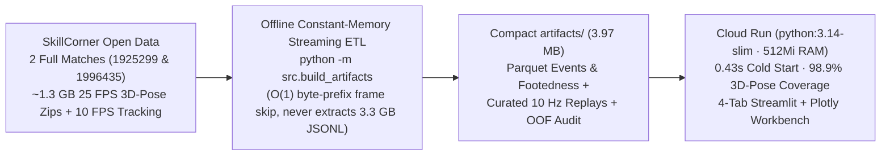

# Biomechanical Football Tactical Advantage & Defensive-Matrix Engine

[](https://football-advantage-engine-371024701820.us-west1.run.app)
[](#local-setup-verification--repo-structure)
[](#architecture--lean-deployment)

Standard spatial football models—isotropic Pitch Control and event-based Expected Goals (xG)—treat players as rotationally symmetric particles, missing how hip orientation, torso twist, tackling stance, and footedness dictate real-time spatial advantage. This engine replaces symmetric arrival kinetics with an **anisotropic 3D biomechanical control surface** coupled to a **Delaunay defensive-structure matrix** ($\lambda_2$ algebraic connectivity & seam exposure $H_\Delta$), uniting an interactive 10 Hz physics match engine with strict out-of-fold validation on full-match SkillCorner 3D Body Pose data.

> **Live Interactive Workbench:** **[https://football-advantage-engine-371024701820.us-west1.run.app](https://football-advantage-engine-371024701820.us-west1.run.app)**

---

## Architecture & Lean Deployment

To serve full-match 3D biomechanical analytics inside a **512 MiB Cloud Run container** with sub-second cold starts, raw multi-gigabyte pose archives are processed offline in constant memory and distilled into compact Parquet/JSON artifacts that ship inside the Docker image.



- **Matches Modeled (`105m × 68m` pitches):** `1925299` (*Brisbane Roar 0–1 Perth Glory*) and `1996435` (*Sydney FC 4–1 Adelaide United*).
- **Runtime Footprint:** `3.97 MB` total `artifacts/` bundle (`785.6 KB` scored events Parquet, `10.9 KB` footedness Parquet, `3.18 MB` curated 10 Hz replays JSON, `6.4 KB` OOF audit JSON); verified `0.43s` load time; `3,974 / 4,020` (**98.9%**) scored events backed by direct 3D pose observations (`46` kinematic fallback).

---

## Biomechanical & Defensive-Matrix Methodology

### 1. Verified 3D Pose Extraction & Footedness Inference (`src/ingest.py`, `src/pose.py`)
- **25 ↔ 10 FPS Exact Frame Sync:** Maps 10 FPS tracking/event frames to 25 FPS 3D body pose via `pose_frame = round(2.5 * tracking_frame)` (exact timestamp match on every even tracking frame; `≤ 20 ms` on odd frames).
- **Non-Inverted Orientation & Stance:** Horizontal hip- and shoulder-facing unit vectors are computed from anatomical left-to-right joint pairs as $\hat{f} = (-\Delta y, \Delta x) / \|\Delta\|$ (empirically verified `99.5%–100.0%` non-inverted against `nose` and `BigToe` reference vectors in SkillCorner's `+z` up frame), yielding signed torso twist $\Delta\theta_{\text{twist}} = \operatorname{atan2}(\hat{f}_{\text{hip}} \times \hat{f}_{\text{sh}},\; \hat{f}_{\text{hip}} \cdot \hat{f}_{\text{sh}})$ and ankle-lead tackling stance $s = (\text{lAnkle}_{xy} - \text{rAnkle}_{xy}) \cdot \hat{f}_{\text{hip}}$ (`Left-Forward` $> +0.10\text{ m}$, `Right-Forward` $< -0.10\text{ m}$, `Square` $|s| \le 0.10\text{ m}$).
- **Provenance & Footedness:** Off-camera frames (`joints: null`) fall back smoothly to velocity/ball-facing vectors with `stance = "Square"` and explicit `pose_source = "kinematic_fallback"` tagging so OOF validation isolates pure `3d_pose`. Because `match.json` lacks preferred-foot metadata, per-player `dominant_foot` (`R`/`L`) and `weak_foot_comfort` ($w \in [0.25, 0.90]$) are inferred empirically from 3D `lBigToe`/`rBigToe`-to-ball contacts (`≤ 0.85 m`, margin `≥ 0.10 m`) with Beta-Binomial shrinkage toward a right-footed prior when $n < 5$.

### 2. Anisotropic Control & Defensive Structure Matrix (`src/physics.py`, `src/matrix.py`)
- **Anisotropic Arrival Surface ($C_{\text{aniso}}$):** Evaluated alongside standard isotropic control ($C_{\text{iso}}$) on a `35 × 22` (`3m`) grid weighted by a goal-threat surface $V(x, y)$:
  $$\tilde{T}_i(\mathbf{r}) = \tau_{\text{react}} + \frac{|\Delta\theta_i(\mathbf{r})|}{\omega_{\max}} + \alpha_{\text{stance}} \cdot \sigma_i(\mathbf{r}) + \frac{\|\mathbf{r} - (\mathbf{r}_i + \mathbf{v}_i\tau_{\text{react}})\|}{v_{\max}}$$
  where $\sigma_i(\mathbf{r}) \in [0, 1]$ penalizes lateral reaches across a defender's locked trailing foot and back-turned pivots ($|\Delta\theta| > 110^\circ$).
- **Defensive Structure Matrix ($M(t)$):** Outfield defenders form a **Delaunay Triangulation** with orientation-weighted mutual cover $M_{ij}(t) = \exp(-d_{ij}/\lambda)\cdot\max(0, \cos(\Delta\theta_{ij}/2))$, quantifying structural cohesion via normalized **Fiedler Algebraic Connectivity ($\lambda_2$)** and flagging expanding seams ($\Delta A > 0$ with rising interior attacking control) via the **Matrix Hole Score ($H_\Delta$)**.

### 3. Action Control Delta ($\Delta C$), Strong/Weak-Side Coupling & 10 Hz Match Engine (`src/physics.py`, `src/simulator.py`)
- **Exact 3-Way Counterfactual $\Delta C$ Decomposition:** Over any action window $[t_0, t_1]$, threat-weighted control shift $\Delta C_{\text{threat}}$ telescopes with exact additivity into **Positional Shift** ($\Delta C_{\text{pos}}$), **Orientation & Wrong-Footing** ($\Delta C_{\text{orient}}$), and **Matrix Distortion & Seam Opening** ($\Delta C_{\text{matrix}}$).
- **Strong/Weak-Side Coupling:** Computes **Pass Release Favorability** ($A_{\text{pass}}$), **Reception & First-Touch Favorability** ($A_{\text{recv}}$), and the **Local Matchup Tensor** pairing the carrier's dominant-foot driving arc against nearest defenders' exposed trailing tackling sides and adjacent passing lanes—running both on real SkillCorner sequences and inside the deterministic 10 Hz Interactive Match Engine (Body Feints, Directional First Touches, and Driven/Disguised Passes).

---

## Strict 5-Fold OOF Validation Results

Evaluated strictly out-of-fold (`StratifiedKFold(n_splits=5)`, fold-internal `SimpleImputer` + `StandardScaler` + `LogisticRegression(C=0.15)`) from [`artifacts/validation_audit.json`](artifacts/validation_audit.json) comparing **Baseline** (Isotropic Pitch Control + Distance) against **Full** (+ Anisotropic Orientation/Stance + Footedness + Defensive Matrix $\lambda_2$ & $H_\Delta$):

| Real SkillCorner Target | Evaluation Slice | N (Pos) | Baseline AUC | Full AUC | Δ AUC | Baseline Brier | Full Brier | Δ Brier |
| --- | --- | ---: | ---: | ---: | ---: | ---: | ---: | ---: |
| **Line-Break Pass Success** | All Events | 1,790 (212) | 0.6202 | **0.7415** | **+0.1213** | 0.1026 | **0.0960** | **−0.0066** |
| **Line-Break Pass Success** | `3d_pose` Only | 1,753 (205) | 0.6228 | **0.7317** | **+0.1089** | 0.1015 | **0.0955** | **−0.0060** |
| **Pass Completion** | All Events | 1,790 (1,521) | 0.5892 | **0.6809** | **+0.0917** | 0.1261 | **0.1223** | **−0.0038** |
| **Pass Completion** | `3d_pose` Only | 1,753 (1,489) | 0.6012 | **0.6864** | **+0.0852** | 0.1259 | **0.1217** | **−0.0042** |
| **High-EPV / Shot Creation** | All Events | 2,059 (571) | 0.6627 | **0.7414** | **+0.0787** | 0.1832 | **0.1656** | **−0.0176** |
| **High-EPV / Shot Creation** | `3d_pose` Only | 2,018 (567) | 0.6540 | **0.7384** | **+0.0844** | 0.1852 | **0.1679** | **−0.0173** |
| **Defender Beaten**\* | All Events | 1,961 (35) | 0.8979 | 0.8866 | −0.0113 | 0.0163 | 0.0163 | 0.0000 |
| **Defender Beaten**\* | `3d_pose` Only | 1,956 (35) | 0.8990 | 0.8829 | −0.0161 | 0.0163 | 0.0166 | +0.0003 |

\* **Note on Defender Beaten (`n = 35` positives, `1.8%` base rate):** Across two matches, raw defender-to-carrier separation distance already yields ~`0.90` ROC-AUC on these 35 rare events; adding 19 biomechanical predictors introduces mild finite-sample variance while keeping Brier calibration flat (`0.0163`). On every well-powered possession, passing, line-break, and EPV outcome, 3D orientation, footedness, and defensive matrix features deliver **`+0.0787` to `+0.1213` ROC-AUC** and consistent Brier score reductions.

**Real-Match Moments Missed by Naive Isotropic Control (`pose_source == "3d_pose"`):**
- **J. Brazete (`RW`, Brisbane Roar 0–1 Perth Glory, 83'):** Wrong-footed defender hip pivot drove anisotropic $\Delta C = +0.1420$ vs. naive isotropic $\Delta C = +0.0254$ (`+11.66 pp` gap).
- **P. Kikianis (`LCB`, Sydney FC 4–1 Adelaide United, 23'):** Naive isotropic control scored the carry-and-pass negative (`−0.0317`), while anisotropic control captured `+0.0709` in hip-orientation advantage.
- **Léo Sena (`LDM`, Sydney FC 4–1 Adelaide United, 62'):** Midfield turn and progressive pass generated anisotropic $\Delta C = +0.1689$ vs. isotropic `+0.0710`.

---

## 4-Tab Workbench Overview

1. **Interactive Biomechanical Match Engine:** Test 4 editable tactical presets (Body Feint, Directional First Touch, Driven/Disguised Pass) with live pitch-control shifts, Delaunay seam deformation, and an exact 3-way $\Delta C$ waterfall.
2. **Real-Match 3D Pose & Defensive Matrix Replay:** Scrub 12 curated 10 Hz sequences across `1925299` & `1996435` (including Phase 406 and goals) with Anisotropic vs. Isotropic overlays, 3D hip-facing arrows, stance badges, Delaunay mesh, and $\Delta C$ / $\lambda_2$ timelines.
3. **Strong/Weak-Side & First-Touch Lab:** Explore and rank passes, one-touch actions, and carries by Anisotropic $\Delta C$, $A_{\text{pass}}$ / $A_{\text{recv}}$, Strong-vs-Weak Matchup Edge, and inferred 3D dominant-foot profiles.
4. **Quantitative Validation Audit:** Inspect the leakage-free 5-fold Stratified OOF ROC-AUC and Brier benchmarks across all targets, toggled between All Events and pure `3d_pose` Only.

---

## Local Setup, Verification & Repo Structure

```bash
# 1. Create and activate virtual environment
python -m venv .venv
# Windows (PowerShell): .\.venv\Scripts\Activate.ps1
# macOS / Linux:        source .venv/bin/activate

# 2. Install lean runtime dependencies
pip install -r requirements.txt

# 3. Run the 6-suite automated invariant verification suite
python tests/verify_pipeline.py

# 4. (Optional) Rebuild artifacts from SkillCorner Open Data
python -m src.build_artifacts --sample-only   # Fast smoke build (~9s, sample_1925299_phase406)
python -m src.build_artifacts                 # Full 2-match streaming build (1925299 & 1996435)

# 5. Launch the 4-tab Streamlit workbench locally
streamlit run main.py
```

```text
football-advantage-engine/
├── main.py                              # 4-Tab Streamlit workbench (loads exclusively from artifacts/)
├── Dockerfile                           # Lean python:3.14-slim Cloud Run image (512Mi RAM)
├── requirements.txt                     # streamlit, plotly, pandas, numpy, scipy, scikit-learn, pyarrow, requests
├── docs/
│   └── ARCHITECTURE.md                  # Full mathematical & systems specification
├── artifacts/                           # Precomputed compact Parquet/JSON bundle (3.97 MB)
│   ├── dynamic_events_enriched.parquet
│   ├── player_footedness.parquet
│   ├── curated_replays.json
│   ├── validation_audit.json
│   └── artifact_manifest.json
├── src/
│   ├── ingest.py                        # GitHub LFS + HF constant-memory zip streaming & frame sync
│   ├── pose.py                          # 3D hip/shoulder vectors, twist, stance, fallback, footedness
│   ├── physics.py                       # 35×22 Anisotropic vs. Isotropic control, A_pass/A_recv, ΔC ablation
│   ├── matrix.py                        # Delaunay mesh, M_ij(t), Fiedler λ₂, Hole Score H_Δ
│   ├── simulator.py                     # Deterministic 10 Hz biomechanical match engine
│   ├── validation.py                    # Strict 5-Fold Stratified OOF benchmark
│   ├── build_artifacts.py               # Offline streaming ETL CLI (--sample-only / full)
│   └── charts.py                        # Plotly tactical pitch maps, waterfalls & audit visuals
└── tests/
    └── verify_pipeline.py               # 6 automated physics, sync, geometry & leakage invariant tests
```

For full mathematical derivations, verified SkillCorner schemas, and design trade-offs, see [`docs/ARCHITECTURE.md`](docs/ARCHITECTURE.md).
