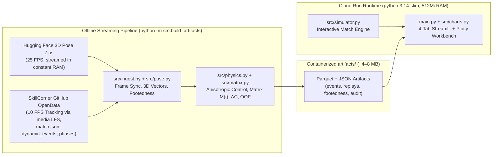

# Architecture: Biomechanical Football Tactical Advantage & Defensive-Matrix Engine

> **Project 4 (`football-advantage-engine`)** — Dual-mode biomechanical tactical analytics platform combining an interactive 2D physics match engine with SkillCorner 3D Body Pose + 10 FPS tracking validation.

---

## 1. System Overview & Dual-Mode Design

Standard football spatial models (isotropic pitch control, raw distance to ball) treat players as rotationally symmetric particles—ignoring hip orientation, torso twist, tackling stance, and footedness. This engine models **anisotropic player biomechanics** coupled with **defensive unit graph geometry** across two integrated modes:

1. **Interactive Biomechanical Match Engine (Physics Sandbox):** Deterministic 10 Hz biomechanical simulator for testing body feints, directional first touches, driven/disguised passes, and strong-vs-weak foot matchups with real-time pitch control, Delaunay matrix deformation, and exact 3-way advantage decomposition.
2. **Real-Match SkillCorner 3D Body Pose + Tracking Validation:** End-to-end empirical validation across both full 3D-pose SkillCorner Open Data matches (`105m × 68m` pitches):
   - **`1925299`** — Brisbane Roar `0–1` Perth Glory (`2024-12-21`, Kayo Stadium, `594.53 MB` zip)
   - **`1996435`** — Sydney FC `4–1` Adelaide United (`2025-02-01`, `614.48 MB` zip)



---

## 2. Lean Cloud Run Deployment & Dependencies

- **Container Target:** Google Cloud Run (`python:3.14-slim`, **512 MiB RAM**, `<1s` cold start).
- **Constant-Memory Offline Pipeline (`python -m src.build_artifacts`):**
  - Streams Hugging Face 3D-pose `.jsonl.zip` archives line-by-line via `zipfile.ZipFile.open()` without decompressing the ~3.3 GB raw JSONL payloads to disk.
  - Supports `--sample-only` using `sample_1925299_phase406.jsonl.gz` (1.8 MB, 309 pose frames) for fast local development and CI verification.
  - Emits compact, pre-aggregated `artifacts/` (~4–8 MB total in Parquet + JSON) that ship directly inside the container image.
- **Ignore Hygiene:** `.gitignore` and `.gcloudignore` exclude `data/raw/` (large zip/JSONL downloads) while allowing compact `artifacts/` to be packaged cleanly for Cloud Run.
- **Core Dependencies (lean):** `streamlit`, `plotly`, `pandas`, `numpy`, `scipy`, `scikit-learn`, `pyarrow`, `requests`.

---

## 3. Verified SkillCorner Data Contracts & Endpoints

All endpoints, schemas, coordinate conventions, and Git LFS rules below were empirically verified via [probe_skillcorner.py](file:///c:/Projects/football-advantage-engine/scripts/probe_skillcorner.py).

| Artifact | Verified Live Source | Format & Size | Key Findings |
| --- | --- | --- | --- |
| 3D Pose Manifest | `raw.githubusercontent.com/SkillCorner/opendata/master/data/bodypose/MANIFEST.json` | JSON | `frame_rate_fps: 25`, `tracking_frame_rate_fps: 10`; lists `1925299` (`623,408,231 B`) & `1996435` (`644,327,811 B`) |
| Full 3D Pose Zips | `huggingface.co/datasets/SkillCorner/opendata-bodypose/resolve/main/raw/{id}.jsonl.zip` | ZIP / JSONL (25 FPS) | `594.53 MB` (`1925299`), `614.48 MB` (`1996435`); stream-read inside zip |
| 3D Pose Sample | `raw.githubusercontent.com/SkillCorner/opendata/master/data/bodypose/sample_1925299_phase406.jsonl.gz` | GZ / JSONL (1.8 MB) | 309 frames (`124487–124795`), 32 players, `50.09%` non-null `joints` (`4,953/9,888`) |
| Match Metadata | `raw.githubusercontent.com/SkillCorner/opendata/master/data/matches/{id}/{id}_match.json` | JSON | `pitch_length: 105`, `pitch_width: 68`, `home_team_side`, `match_periods`, `players[].player_role`; **no dominant foot field** |
| Dynamic Events | `raw.githubusercontent.com/SkillCorner/opendata/master/data/matches/{id}/{id}_dynamic_events.csv` | CSV (322 cols) | `5,222` rows (`1925299`): `passing_option` (2,734), `player_possession` (1,054), `on_ball_engagement` (936), `off_ball_run` (498) |
| Phases of Play | `raw.githubusercontent.com/SkillCorner/opendata/master/data/matches/{id}/{id}_phases_of_play.csv` | CSV (44 cols) | `483` rows (`1925299`); TIP (`build_up`, `create`, `finish`, `direct`, `quick_break`, `transition`, `chaotic`, `set_play`) & OTIP blocks |
| Extrapolated Tracking | `media.githubusercontent.com/media/SkillCorner/opendata/master/data/matches/{id}/{id}_tracking_extrapolated.jsonl` | JSONL (10 FPS, Git LFS) | `raw.githubusercontent.com` serves LFS pointer; `media.githubusercontent.com` serves HTTP `200` (`92.59 MB` for `1925299`) |

### Verified 3D Body Pose Record Schema & Accuracy
- **Frame keys:** `frame`, `timestamp`, `period`, `ball_data` (`x, y, z, is_detected`), `possession`, `image_corners_projection`, `player_data`.
- **Player entry keys:** `player_id`, `x`, `y`, `is_detected`, `joints` (note: `is_detected == True` can still have `joints: null` — 20 of 4,973 detected rows in sample — so ingestion always checks `joints is not None`).
- **Joint entry schema (29 joints):** `joints[name] = {"xyz": [x, y, z], "p90_mae_cm": float}` (coordinates live inside `xyz` array, not flat `x/y/z` keys).
- **Verified `p90_mae_cm` accuracy (`sample_1925299_phase406`, `n = 4,953`):**
  - Shoulders (`lShoulder`/`rShoulder`): median `5.56–5.73 cm` (P90 `7.16–7.26 cm`)
  - Hips (`lHip`/`rHip`): median `7.27–7.78 cm` (P90 `10.74–11.46 cm`)
  - Ankles (`lAnkle`/`rAnkle`): median `12.48–12.62 cm` (P90 `18.17–20.65 cm`)
  - Big Toes (`lBigToe`/`rBigToe`): median `14.99–15.08 cm` (P90 `22.48–25.63 cm`)

---

## 4. 3D Pose Extraction, Synchronization & Footedness (`src/pose.py`, `src/ingest.py`)

### 4.1 Exact Frame Synchronization & Pitch Normalization
- **Frame Mapping:** 3D pose runs at **25 FPS**; tracking and dynamic events run at **10 FPS**:
  $$\text{pose\_frame} = \operatorname{round}(2.5 \times \text{tracking\_frame})$$
  Yields exact timestamp alignment on every even tracking frame and $\le 20\text{ ms}$ nearest-frame alignment on odd tracking frames.
- **Coordinate Normalization:** All $(x, y)$ positions, velocities, and facing vectors are rotated per period using `match.json["home_team_side"]` so the attacking team always attacks left-to-right (`+x` toward opponent goal at `(+52.5, 0)` on `[-52.5, +52.5] × [-34.0, +34.0]`).

### 4.2 Verified Biomechanical Vectors
All orientation features use horizontal `(x, y)` centroid-relative geometry (ignoring absolute pitch `z`, though `nose.z > lAnkle.z` holds in `99.96%` of valid frames, confirming right-handed `+z` up):

- **Hip Forward Unit Vector ($\hat{f}_{\text{hip}}$):** Given $(\Delta x, \Delta y) = \text{rHip}_{xy} - \text{lHip}_{xy}$ (anatomical Left → Right),
  $$\hat{f}_{\text{hip}} = \frac{(-\Delta y,\; \Delta x)}{\|\Delta\|}$$
  Empirically verified non-inverted across all `4,953` valid sample player-frames: `100.0%` positive alignment with `nose - mid_shoulder`, `99.5%` with `nose - mid_hip`, and `99.6%` with `avg(BigToe - Ankle)`.
- **Shoulder Forward Unit Vector ($\hat{f}_{\text{sh}}$) & Torso Twist:** Computed identically from $\text{rShoulder}_{xy} - \text{lShoulder}_{xy}$. Signed torso twist:
  $$\Delta\theta_{\text{twist}} = \operatorname{atan2}\!\left(\hat{f}_{\text{hip}} \times \hat{f}_{\text{sh}},\; \hat{f}_{\text{hip}} \cdot \hat{f}_{\text{sh}}\right)$$
  where $\mathbf{a} \times \mathbf{b} = a_x b_y - a_y b_x$ is the 2D scalar cross product.
- **Tackling / Stride Stance:** Lead-foot projection onto hip facing:
  $$s = (\text{lAnkle}_{xy} - \text{rAnkle}_{xy}) \cdot \hat{f}_{\text{hip}}$$
  - `Left-Forward`: $s > +0.10\text{ m}$
  - `Right-Forward`: $s < -0.10\text{ m}$
  - `Square`: $|s| \le 0.10\text{ m}$

### 4.3 Off-Camera Fallback & Provenance Tagging
When `joints` is `null` (or hip/ankle joints are missing), `src/pose.py` preserves continuity without corrupting pure 3D validation:
- Estimate $\hat{f}_{\text{hip}}$ smoothly from the player's velocity unit vector $\hat{v}$ when speed $\|\mathbf{v}\| \ge 1.2\text{ m/s}$, blended smoothly with the ball-facing unit vector $\hat{u}_{\text{ball}}$ (defaulting to $\hat{u}_{\text{ball}}$ when $\|\mathbf{v}\| < 1.2\text{ m/s}$).
- Set `stance = "Square"` and `torso_twist = 0.0`.
- Stamp every observation with `pose_source = "3d_pose" | "kinematic_fallback"` so Tab 4 validation reports metrics both overall and strictly isolated on `pose_source == "3d_pose"`.

### 4.4 Empirical Dominant Foot Inference
Because `match.json` contains no preferred-foot metadata, `src/pose.py` infers footedness empirically across all `player_possession` touch/pass frames with valid 3D `lBigToe`, `rBigToe`, and detected `ball_data`:
1. Compute 2D toe-to-ball distances $d_L = \|\text{lBigToe}_{xy} - \mathbf{b}_{xy}\|$ and $d_R = \|\text{rBigToe}_{xy} - \mathbf{b}_{xy}\|$.
2. Accept a foot contact observation only when $\min(d_L, d_R) \le 0.85\text{ m}$ and $|d_L - d_R| \ge 0.10\text{ m}$ (eliminating ambiguous two-foot or out-of-range frames).
3. Aggregate counts $(n_R, n_L)$ per `player_id` and apply Beta-Binomial shrinkage toward a right-footed population prior ($\alpha_0 = 4.0, \beta_0 = 1.0$, equivalent to 5 pseudo-observations at 80% right-footed) when $n = n_R + n_L < 5$:
   - `dominant_foot` $\in \{\text{"R"}, \text{"L"}\}$ from posterior majority $\hat{p}_R = \frac{n_R + \alpha_0}{n + \alpha_0 + \beta_0}$.
   - `weak_foot_comfort` $w \in [0.25, 0.90]$, scaled monotonically from the posterior non-dominant usage share $1 - \max(\hat{p}_R, 1 - \hat{p}_R)$.

---

## 5. Core Physics & Tactical Advantage Models (`src/physics.py`, `src/matrix.py`)

### 5.1 Anisotropic Control Field ($C_{\text{aniso}}$) vs. Standard Isotropic Control ($C_{\text{iso}}$)
Evaluated side by side on a **35 × 22 pitch grid** (`3.0m` spatial resolution) weighted by a spatial goal-threat surface $V(x, y)$ (monotonically increasing toward the attacking goal at `(+52.5, 0)` and peaking inside Zone 14 / penalty area).

For each player $i$ at $(\mathbf{r}_i, \mathbf{v}_i)$ targeting grid cell $\mathbf{r}$:
$$\tilde{T}_i(\mathbf{r}) = \tau_{\text{react}} + \frac{|\Delta\theta_i(\mathbf{r})|}{\omega_{\max}} + \alpha_{\text{stance}} \cdot \sigma_i(\mathbf{r}) + \frac{\|\mathbf{r} - (\mathbf{r}_i + \mathbf{v}_i\tau_{\text{react}})\|}{v_{\max}}$$

- **$\Delta\theta_i(\mathbf{r}) \in [-\pi, \pi]$:** Signed hip-pivot angle from $\hat{f}_{\text{hip},i}$ to target direction $\mathbf{r} - \mathbf{r}_i$.
- **$\sigma_i(\mathbf{r}) \in [0, 1]$:** Biomechanical stance & back-turned vulnerability penalty:
  - Penalizes lateral reaches across a defender's **trailing/weak tackling foot** (e.g., reaching to the defender's right when `Left-Forward` locks the right hip behind, or to the defender's left when `Right-Forward`).
  - Adds an elevated **back-turned vulnerability penalty** when $|\Delta\theta_i(\mathbf{r})| > 110^\circ$, reflecting deceleration + full-hip turn cost.
- **Standard Isotropic Baseline ($C_{\text{iso}}$):** Drops both the angular turn term and stance penalty ($\frac{|\Delta\theta_i|}{\omega_{\max}} = 0$, $\sigma_i = 0$).
- **Grid Ownership Probability:** Soft-min / logistic arrival-time competition between attacking and defending players at each grid cell yields $C_{\text{aniso}}(x, y) \in [0, 1]$ and $C_{\text{iso}}(x, y) \in [0, 1]$, plus threat-weighted scalar control $C_{\text{threat}} = \sum_{x,y} C_{\text{aniso}}(x,y)\,V(x,y)$.

### 5.2 Defensive Structure Matrix ($M(t)$) & Seam/Hole Detection (`src/matrix.py`)
Models the outfield defending unit (excluding the goalkeeper) as a spatial-orientation graph:

1. **Delaunay Triangulation:** Built over active outfield defender positions $\mathbf{r}_1, \dots, \mathbf{r}_N$ via `scipy.spatial.Delaunay`.
2. **Mutual Cover Matrix ($M(t)$):** For defender pairs $(i, j)$ (evaluated on the defensive graph),
   $$M_{ij}(t) = \exp\!\left(-\frac{d_{ij}}{\lambda}\right) \cdot \max\!\left(0,\; \cos\!\left(\frac{\Delta\theta_{ij}}{2}\right)\right)$$
   where $d_{ij} = \|\mathbf{r}_i - \mathbf{r}_j\|$ and $\Delta\theta_{ij} = \angle(\hat{f}_{\text{hip},i}, \hat{f}_{\text{hip},j})$ measures orientation coherence.
3. **Block Integrity Metrics:**
   - **Normalized Fiedler Algebraic Connectivity ($\lambda_2$):** Second-smallest eigenvalue of the normalized weighted Laplacian $\mathcal{L}_{\text{sym}} = I - D^{-1/2} M D^{-1/2}$ (captures structural cohesion; drops sharply when a defender is dragged out of line or turned away from teammates).
   - **Mean Cover Compactness:** Mean edge cover weight $\bar{M}_{\text{edge}}$ across Delaunay triangles.
4. **Matrix Seam / Hole Score ($H_\Delta$):** For each Delaunay triangle $T_k$ with area $A_k$, interior attacking anisotropic control $\bar{C}_{\text{att}}(T_k)$, and threat weight $\bar{V}(T_k)$:
   - Static hole exposure: $h_k(t) = A_k \cdot \bar{C}_{\text{att}}(T_k) \cdot \bar{V}(T_k) \cdot (1 - \bar{M}_{T_k})$.
   - Dynamic seam opening over $[t_0, t_1]$: flags triangles where area expands ($\Delta A_k > 0$) while attacking anisotropic control inside $T_k$ rises ($\Delta \bar{C}_{\text{att}}(T_k) > 0$), aggregated into $H_\Delta$.

### 5.3 Action Control Delta ($\Delta C$) & Exact 3-Way Counterfactual Decomposition
Over an action window $[t_0, t_1]$ (`pass`, `first_touch`, `feint/carry`), defensive matrix cover $M(t)$ couples into effective defender arrival times inside exposed seams via a local cover-deficit latency factor $\beta_{\text{matrix}} \cdot \text{deficit}(x,y; M)$. Define total threat-weighted attacking control as $C_{\text{threat}}(\mathbf{P}, \mathbf{\Theta}, \mathbf{M}) = \sum_{x,y} C_{\text{aniso}}(x,y; \mathbf{P}, \mathbf{\Theta}, \mathbf{M})\, V(x,y)$, where $\mathbf{P} = \{(x_i, y_i, \mathbf{v}_i)\}$, $\mathbf{\Theta} = \{(\hat{f}_{\text{hip},i}, \Delta\theta_{\text{twist},i}, s_i)\}$, and $\mathbf{M} = M(t)$.

Evaluating the exact telescoping counterfactual sequence guarantees strict additivity ($\Delta C_{\text{pos}} + \Delta C_{\text{orient}} + \Delta C_{\text{matrix}} \equiv \Delta C_{\text{threat}}$):

1. **Positional Shift:**
   $$\Delta C_{\text{pos}} = C_{\text{threat}}(\mathbf{P}_1, \mathbf{\Theta}_0, \mathbf{M}_0) - C_{\text{threat}}(\mathbf{P}_0, \mathbf{\Theta}_0, \mathbf{M}_0)$$
   Moves all player positions and velocities while holding orientations, stances, and matrix cover state fixed at $t_0$.
2. **Orientation & Wrong-Footing:**
   $$\Delta C_{\text{orient}} = C_{\text{threat}}(\mathbf{P}_1, \mathbf{\Theta}_1, \mathbf{M}_0) - C_{\text{threat}}(\mathbf{P}_1, \mathbf{\Theta}_0, \mathbf{M}_0)$$
   Updates $\hat{f}_{\text{hip}}$, torso twist, and tackling stance lead $s$ to $t_1$ at fixed $\mathbf{P}_1, \mathbf{M}_0$.
3. **Matrix Distortion & Seam Opening:**
   $$\Delta C_{\text{matrix}} = C_{\text{threat}}(\mathbf{P}_1, \mathbf{\Theta}_1, \mathbf{M}_1) - C_{\text{threat}}(\mathbf{P}_1, \mathbf{\Theta}_1, \mathbf{M}_0)$$
   Applies the change in Delaunay hole exposure ($H_\Delta$) and algebraic connectivity ($\lambda_2$) loss.

### 5.4 Strong/Weak-Side Coupling (`Passer ↔ Receiver ↔ Defenders`)
- **Pass Release Favorability ($A_{\text{pass}} \in [-1, 1]$):** Scores alignment of the outgoing pass vector $\hat{u}_{\text{pass}}$ with the passer's open strong-foot striking arc (offset laterally to dominant foot relative to $\hat{f}_{\text{hip}}$) vs. closed-hip / weak-foot constraint, modulated by `weak_foot_comfort` $w$.
- **Reception & First-Touch Favorability ($A_{\text{recv}} \in [-1, 1]$):** Scores whether the incoming ball trajectory arrives onto the receiver's back/strong foot with hips open toward goal (unlocking a 1-touch shot or progressive line-breaking pass) vs. forcing a deadening control touch back onto the weak foot / closed hip.
- **Local Matchup Tensor:** Computes net strong-vs-weak corridor advantage pairing the ball carrier's dominant-foot driving arc against the nearest defenders' exposed trailing/weak tackling sides (from stance $s$ and $\hat{f}_{\text{hip}}$) plus adjacent teammates' open strong-foot passing lanes.

---

## 6. Interactive Match Engine Dynamics (`src/simulator.py`)

Deterministic 2D biomechanical step simulator (`dt = 0.1s`, `1.5–2.0s` rollout = `15–20` frames) powering Tab 1:
- **Defender Dynamics:** Each defender tracks the ball carrier subject to reaction latency $\tau_{\text{react}}$, finite angular turn rate $\omega_{\max}$ (limiting hip rotation per step), linear acceleration/speed bounds ($a_{\max}, v_{\max}$), and inter-defender matrix spring coupling pulling neighbors back toward mutual cover spacing.
- **Interactive Tactical Actions:**
  1. **Body Feint:** Carrier initiates a shoulder/hip fake ($\Delta\theta_{\text{twist}}$ lead) that induces defender momentum overshoot + hip rotation toward the fake side before cutting onto the strong foot, exposing a Delaunay matrix seam.
  2. **Directional First Touch:** Compares an open-body strong-foot first touch into progressive space against a closed weak-foot touch.
  3. **Driven / Disguised Pass:** Simulates ball flight and defender interception while computing live $A_{\text{pass}}$, $A_{\text{recv}}$, and the exact 3-way $\Delta C$ decomposition.

---

## 7. 4-Tab Streamlit + Plotly Workbench (`main.py`, `src/charts.py`)

| Tab | Title | Core Capabilities & Visuals |
| --- | --- | --- |
| **Tab 1** | **Interactive Biomechanical Match Engine** | Preset tactical scenarios (*Inverted Winger Feint vs. Low Block*, *Back-Foot Half-Space Reception*, *Wrong-Footed Fullback 1v1*, *Central Line-Break Pass*) + editable positions, strong foot (`L`/`R`), hip facing, and defender tackling stance (`L-Fwd`/`R-Fwd`/`Square`); interactive Feint / First Touch / Pass rollout with stepped/animated control surface, Delaunay mesh deformation, highlighted seam/hole triangle, and 3-way $\Delta C$ waterfall. |
| **Tab 2** | **Real-Match 3D Pose & Defensive Matrix Replay** | Curated high-impact sequences from `1925299` & `1996435` (including Brisbane Roar Phase 406, goals, line breaks, and top-$\Delta C$ dribbles/passes); 10 Hz frame scrubber, Anisotropic vs. Isotropic control overlay toggle, 3D hip-facing arrows + stance badges, Delaunay defensive mesh, and synchronized frame-by-frame $\Delta C$ & $\lambda_2$ integrity timeline. |
| **Tab 3** | **Strong/Weak-Side & First-Touch Lab** | Match-level leaderboard and event explorer across both matches ranking passes, receptions, and carries by Anisotropic $\Delta C$, $A_{\text{pass}}$ / $A_{\text{recv}}$, and Strong-vs-Weak Matchup Edge—highlighting concrete moments where naive isotropic control or `xshot` missed orientation/stance vulnerability. |
| **Tab 4** | **Quantitative Validation Audit** | Strict 5-Fold Stratified Out-of-Fold (OOF) benchmark comparing **Baseline** (Isotropic Pitch Control + Distance) vs. **+ Biomechanics** (Anisotropic Orientation/Stance + Footedness + Defensive Matrix $\lambda_2$ & $H_\Delta$) across real SkillCorner targets, reported **overall** and strictly on **`pose_source == "3d_pose"`**. |

### Tab 4 OOF Validation Protocol & Real SkillCorner Targets
All models use `StratifiedKFold(n_splits=5, shuffle=True, random_state=42)` with fold-internal preprocessing (`StandardScaler` + imputation inside `sklearn.pipeline.Pipeline`) to prevent any data leakage:
1. **Defender Beaten:** `on_ball_engagement` rows targeting `beaten_by_possession | beaten_by_movement` — evaluated via **ROC-AUC** & **Brier Score**.
2. **Pass Completion & Line-Break Success:** `player_possession` passes targeting `pass_outcome == "successful"` and line-break outcomes (`first_line_break | second_last_line_break | last_line_break`) — evaluated via **ROC-AUC** & **Brier Score**.
3. **High-EPV / Shot Creation:** `player_possession` rows targeting top-quartile `possession_epv_total` / `pass_epv_total` and `lead_to_shot` — evaluated via **ROC-AUC** & **Brier Score**.

---

## 8. Directory Layout & Module Responsibilities

```text
football-advantage-engine/
├── main.py                      # 4-Tab Streamlit entry point (loads artifacts/ + simulator)
├── Dockerfile                   # Lean python:3.14-slim image (512Mi Cloud Run target)
├── requirements.txt             # Lean runtime dependencies
├── .gitignore / .gcloudignore   # Excludes data/raw/; ships compact artifacts/
├── docs/
│   └── ARCHITECTURE.md          # This specification
├── scripts/
│   └── probe_skillcorner.py     # Temporary read-only live SkillCorner data probe
├── artifacts/                   # Compact (~4–8 MB) Parquet/JSON outputs built offline
│   ├── artifact_manifest.json
│   ├── player_footedness.parquet
│   ├── dynamic_events_enriched.parquet
│   ├── curated_replays.json
│   └── validation_audit.json
├── src/
│   ├── ingest.py                # GitHub raw/media-LFS + HF streaming zip readers & frame sync
│   ├── pose.py                  # 3D hip/shoulder vectors, torso twist, stance, fallback, footedness
│   ├── physics.py               # 35×22 grid Anisotropic vs. Isotropic control, V(x,y), A_pass/A_recv, ΔC ablation
│   ├── matrix.py                # Delaunay triangulation, M_ij(t), Fiedler λ₂, compactness, Seam/Hole score H_Δ
│   ├── simulator.py             # Deterministic 10 Hz biomechanical match engine (Feint, Touch, Pass)
│   ├── validation.py            # Strict 5-Fold Stratified OOF benchmark (overall & 3d_pose-only)
│   ├── build_artifacts.py       # CLI: python -m src.build_artifacts [--sample-only]
│   └── charts.py                # Plotly pitch maps, Delaunay overlays, ΔC waterfalls, audit charts
└── tests/
    └── verify_pipeline.py       # Automated physics, geometry, sync, and leakage test suite
```

---

## 9. Automated Verification Suite (`tests/verify_pipeline.py`)

Before any deployment or artifact build is accepted, `tests/verify_pipeline.py` must pass six core invariant checks:

1. **3D Orientation Sign & Stance Classification:** Verifies `lHip → rHip` produces a non-inverted forward unit vector (aligned with `nose` and `BigToe`) and accurately classifies `Left-Forward` ($s > +0.10\text{ m}$), `Right-Forward` ($s < -0.10\text{ m}$), and `Square` ($|s| \le 0.10\text{ m}$).
2. **Exact Frame Synchronization:** Confirms `pose_frame = round(2.5 * tracking_frame)` maps even tracking frames exactly and matches Phase 406 bounds (`49795–49918` → `124487–124795`).
3. **Biomechanical Penalty Monotonicity:** Confirms a back-turned ($|\Delta\theta| > 110^\circ$) or weak-stance defender yields strictly higher $\tilde{T}_i(\mathbf{r})$ and strictly lower defender control than an identically positioned square, forward-facing defender.
4. **Defensive Matrix Structural Sensitivity:** Confirms dragging a defender out of line via a body feint strictly decreases normalized Fiedler connectivity $\lambda_2$ and strictly increases Delaunay Hole Score $H_\Delta$.
5. **Exact 3-Way $\Delta C$ Additivity:** Asserts $|\Delta C_{\text{pos}} + \Delta C_{\text{orient}} + \Delta C_{\text{matrix}} - \Delta C_{\text{threat}}| < 10^{-9}$ across all simulated and real-match action windows.
6. **OOF Validation Leakage Isolation:** Verifies zero train/test index overlap per fold, fold-local scaler/imputer fitting inside `Pipeline`, and clean separation of `pose_source == "3d_pose"` evaluation slices.
